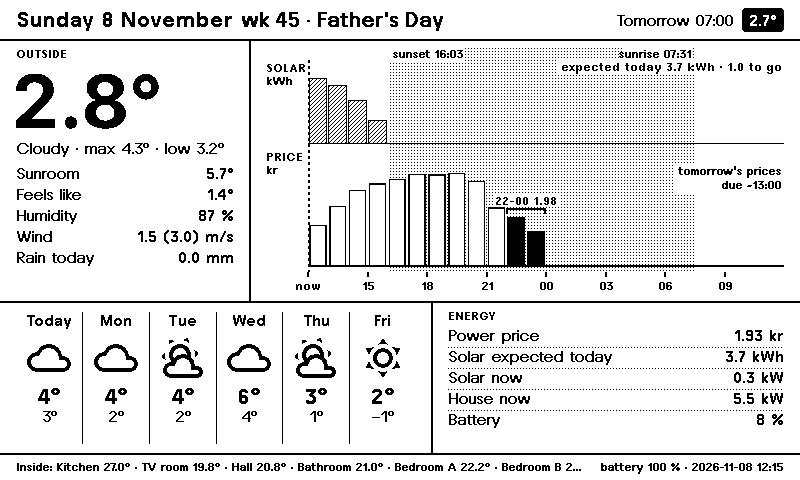
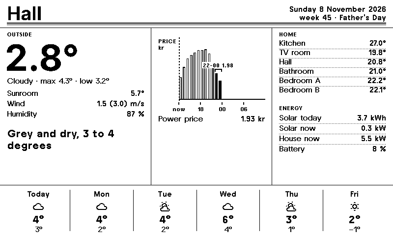
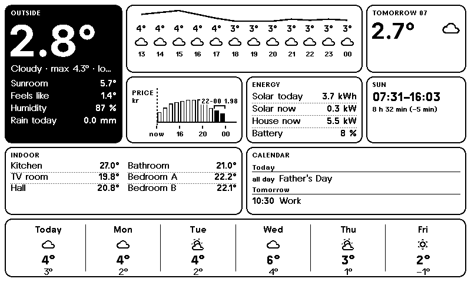
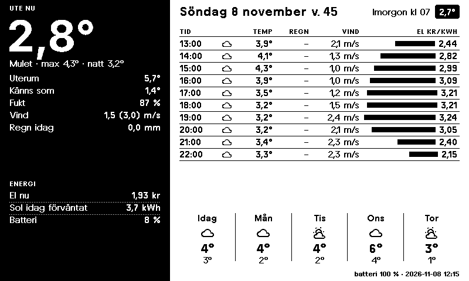
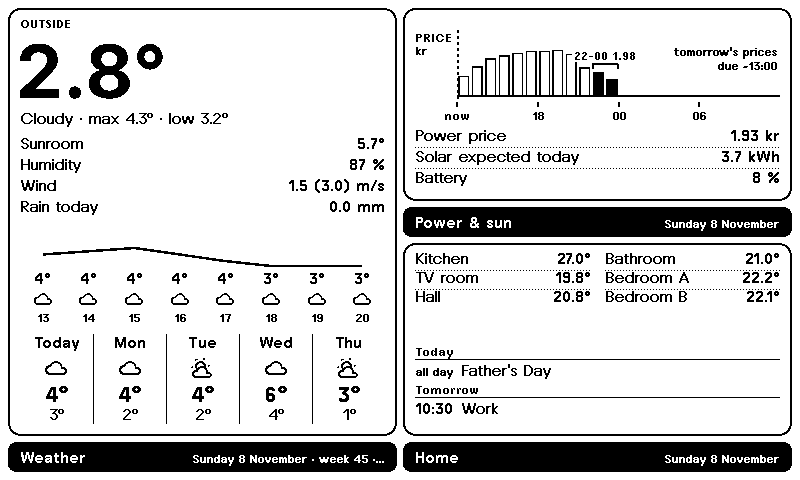
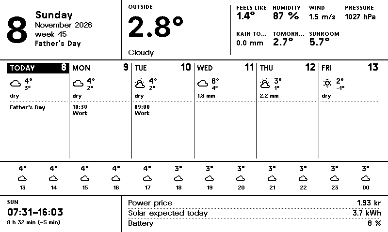
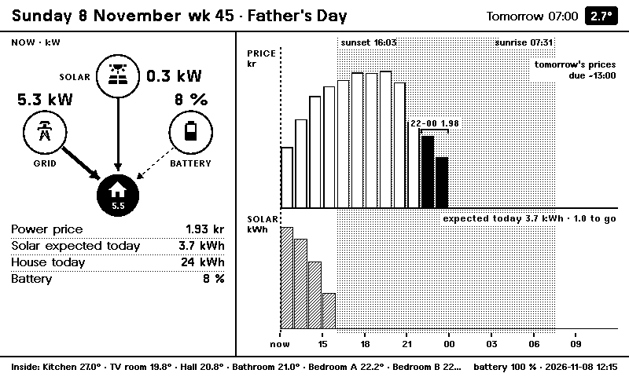
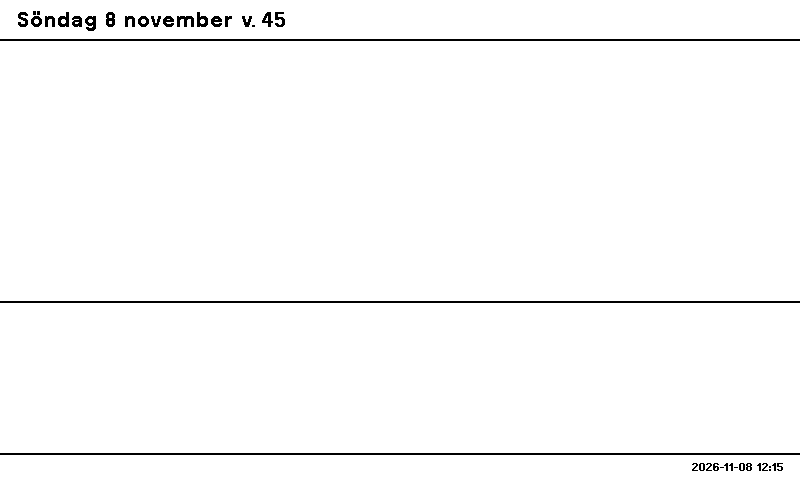

# paperboard

**Designed e-ink dashboards from Home Assistant data, served straight to TRMNL devices.**

paperboard draws dense, readable dashboards for 1-bit and greyscale e-ink panels, using your
Home Assistant data, **inside Home Assistant**:

- **No browser, no add-on, no cloud.** It works on Home Assistant OS, Supervised and Container
  installs alike.
- **It is the device's server.** TRMNL devices (OG, X, and DIY/BYOD panels running TRMNL
  firmware) talk to Home Assistant directly.
- **Other clients:** ESPHome displays, Kindles and other image clients can fetch the same image
  from a URL.



## Why

**No sensor is ever required.** A home without solar panels, a battery, a CO₂ sensor or an
electricity price still gets a clean screen:
- **Missing data:** a missing value shows "—", or that section collapses and its neighbours
  take the space.
- **Gone entities:** a Repairs notice tells you which entity is gone.
- **Enforced:** every widget and every bundled layout is tested against a house with **zero**
  entities, and against garbage data, on every change.

## Layouts

Seven layouts are bundled. Each is a YAML file, and you can write your own.

| | |
|---|---|
| **Tidslinjen** — now, expected solar and price on one 24-hour axis, six days, energy | **Tidningen** — a newspaper page with a written headline; warning days invert |
|  |  |
| **Bento** — tiles with a black hero | **Tavlan** — the morning board: hour by hour with price |
|  |  |
| **TRMNL** — TRMNL's own visual language | **Almanackan** — calendar first: the week with weather and events |
|  |  |
| **Energi** — energy flow, price and expected solar stacked on one axis | **The same Tidslinjen in a house with no entities at all** |
|  |  |

**Language:** Swedish and English, following Home Assistant's language unless a layout pins
one.

## Install

1. In HACS, add this repository as a custom repository (category *Integration*), then install
   **Paperboard**. It needs Home Assistant **2026.3** or newer.
2. Restart Home Assistant, then go to **Settings → Devices & services → Add integration →
   Paperboard**.
   - Give the **base URL** your devices use to reach Home Assistant.
   - Use the **LAN address** (e.g. `http://192.168.1.10:8123`), not the cloud URL.

## Set up a screen

1. **Roles:** on the Paperboard entry, open **Configure → Sensors and data (roles)** and pick
   what each role means in your home. Leave anything you don't have empty.

   | Role | Typical entity |
   |---|---|
   | Weather (forecast) | `weather.home` |
   | Outdoor / second temperature, feels-like, humidity, rain today | weather-station sensors |
   | Electricity price | Nord Pool (core or HACS), ENTSO-e |
   | Expected solar energy today | Forecast.Solar or Solcast "energy production today": the hourly curve is read from the same integration |
   | Solar / grid / house / battery power, house energy today, battery charge | inverter and meter sensors. Tick **"Grid meter reports export as positive"** for Huawei-style meters. |
   | Rooms, calendars | any number of temperature sensors and calendars |
2. **Screen:** **Add screen**. Pick a name and a layout. Leave **Panel** on *Automatic*: it
   follows the model the device reports, from 58 TRMNL models, Kindles and BYOD panels.
3. **Pair:** press the screen's **Pair device** button. You then have **5 minutes**.
   - On the device's setup portal, choose **Custom server** and enter the base URL.
   - Pairing only works from your local network, never through the cloud URL.

Each screen gets:
- an **image entity**, which previews in a *picture-entity* card;
- **battery**, **Wi-Fi signal**, **firmware** and **last check-in** sensors;
- a **Missed check-in** problem sensor, which turns on after 3 missed polls.

The device redraws only when the picture changed, which saves flashes and battery.

## Your own layouts and schedules

- **Layouts:** put `*.yaml` files in `/config/paperboard/`. They are picked up within 30 s; a
  broken file shows a Repairs issue and the last working version keeps rendering.
  - Format: [docs/design/layout-schema.md](docs/design/layout-schema.md). It has a CSS-like
    grid with named areas, 18 widget types, rules, boxes and black tiles.
- **Schedules:** a schedule file switches layouts by time of day and condition. For example,
  *Tavlan* from 07:00 to 08:00 on school days, and a quiet night layout that wakes the device
  once an hour. See [Schedules](docs/design/layout-schema.md#schedules-sprint-03-t-06) and
  [refresh policy](docs/design/refresh-policy.md).
- **Other clients:** ESPHome, Kindle, TRMNL Alias and LaraPaper:
  [docs/clients.md](docs/clients.md).

## How it works

```
HA states + services (forecast, prices, solar, calendars)
  → snapshot (event loop) → SVG layout (executor) → resvg → exact 1/2/4-bit PNG
  → /api/display (TRMNL firmware) · image URL (others) · image entity (HA)
```

**Design documents** are in [docs/design/](docs/design/):
- [device API](docs/design/device-api.md), including its security review;
- [rendering](docs/design/rendering.md);
- [data sources](docs/design/data-sources.md);
- [testing](docs/design/testing.md).

**Rendering budget:** the densest layout renders in ~80 ms, with frames of 5–8 kB.

## FAQ

- **"I don't have a CO₂ sensor / solar panels / a battery."**
  - Nothing breaks: those sections are left out.
  - A role bound to an entity that later disappears raises a Repairs issue.
- **"The screen shows GAMMAL BILD / STALE IMAGE."**
  - The last render failed, and the last good image is being shown.
  - See the screen's **Render error** sensor and the integration's diagnostics.
- **"It renders tiny on my TRMNL X."**
  - Layouts scale to the panel. Some widget spacing does not scale yet (tracked).

## Credits

- **Device API, PNG/BMP encoders and battery curve:** ported from the author's own TRMNL BYOS
  server (MIT).
- **Prior art:** [cryptomilk/hass-eink-dashboard](https://github.com/cryptomilk/hass-eink-dashboard)
  showed that resvg inside Home Assistant works.
- **Fonts:** TRMNL12/16/21 (© Heavyweight Digital Type Foundry) and Inter (© The Inter Project
  Authors), both SIL OFL 1.1.
- **Icons:** Material Design Icons (Pictogrammers, Apache-2.0).

## Licence

Apache-2.0.
